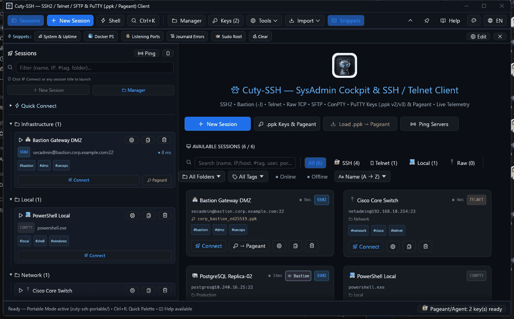
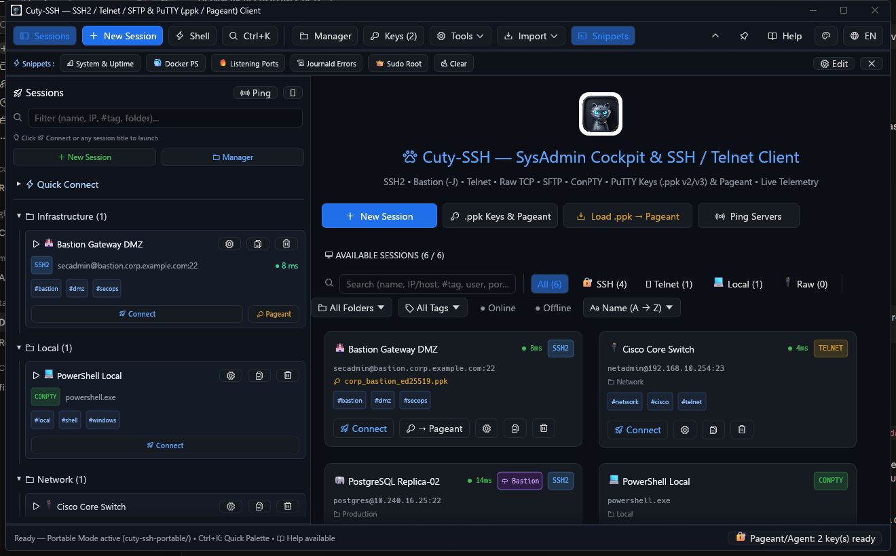
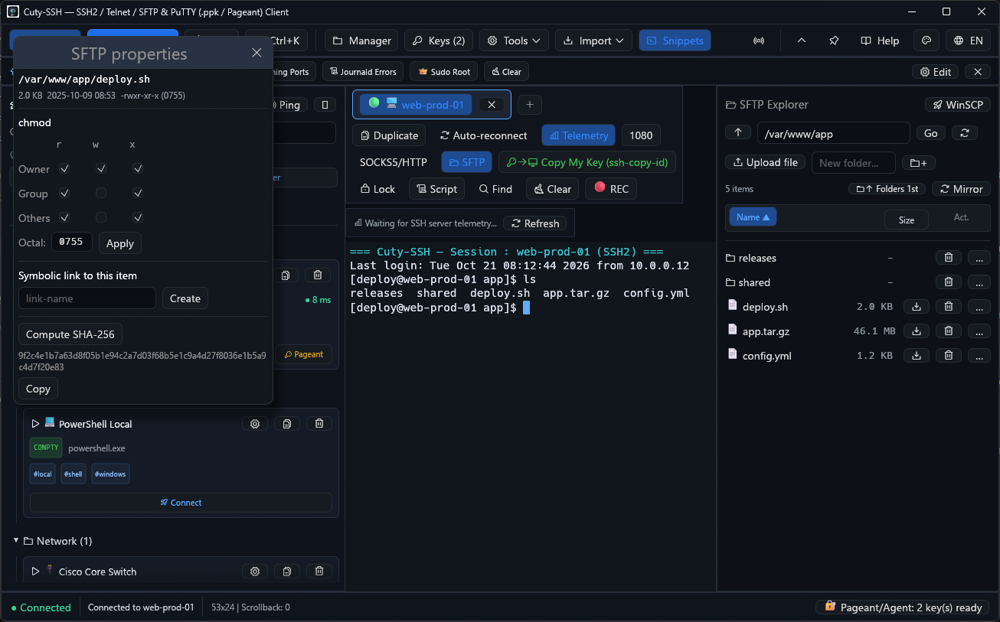
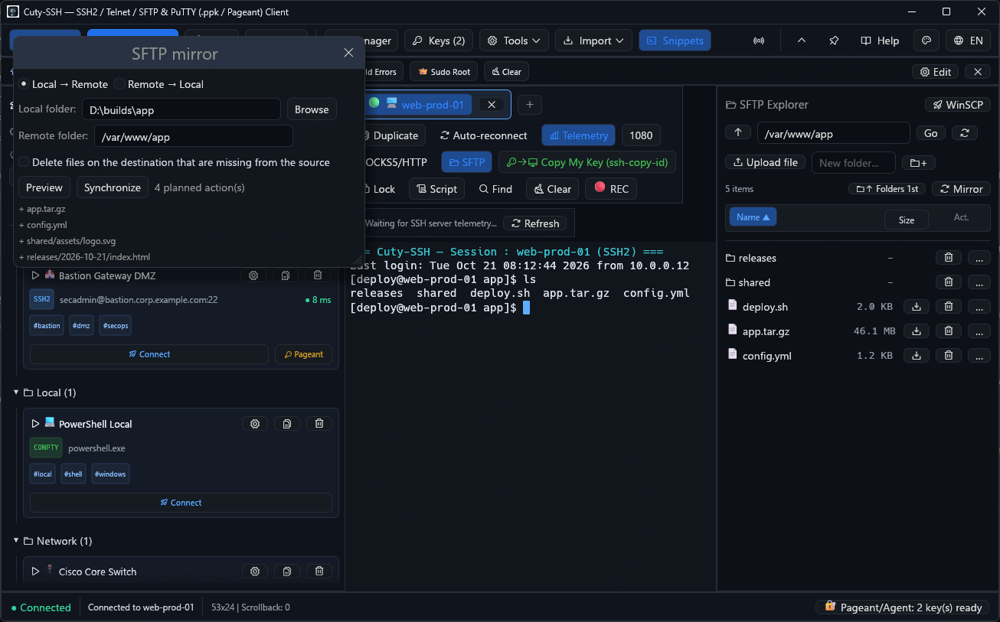
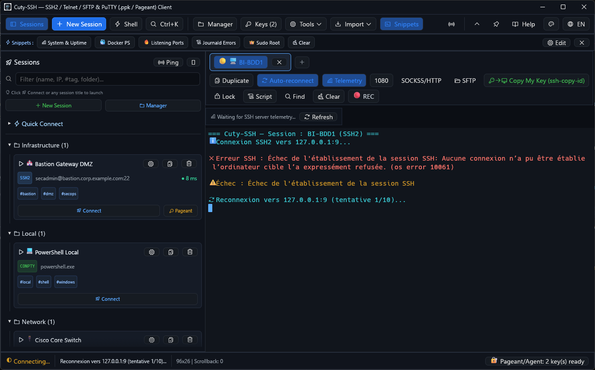

<div align="center">

# Cuty-SSH

### Fast, Native Windows SSH2, SFTP, Telnet, Raw TCP & ConPTY Connection Manager in Pure Rust


[](https://github.com/laurentvv/cuty-ssh/releases)
[](https://github.com/laurentvv/cuty-ssh/actions)
[](https://www.rust-lang.org/)
[-0078d4?style=flat-square&logo=windows)](https://github.com/laurentvv/cuty-ssh/releases)
[-8a2be2?style=flat-square)](https://github.com/emilk/egui)
[](https://crates.io/crates/russh)
[](#5-bilingual-ui-en--fr--in-app-illustrated-user-guide--help)
[](LICENSE)

<p align="center">
  
</p>

[**⬇ Download Latest Release (`v0.8.0`)**](#download--quick-start) · [**🇫🇷 Version Française**](README.fr.md) · [**Animated Tour**](#screenshots--animated-tour) · [**Key Features**](#key-features) · [**CLI Automation**](#8-universal-cli-launcher--headless-automation-plink--ssh-alternative) · [**Architecture**](#architecture) · [**Contributing**](#contributing)

</div>

---

## Overview

**Cuty-SSH** (`v0.8.0`) is a single-binary, portable, GPU-accelerated (**DirectX 12 / wgpu**) terminal emulator and sysadmin connection cockpit for Windows written in **100% safe, async Rust (`russh` + `egui` + `tokio`)** with **zero external binary dependencies** (no `putty.exe` or `kitty.exe` wrapper).

It bridges the gap between the classic **PuTTY / KiTTY** ecosystem and modern **OpenSSH** workflows:
- Load **PuTTY `.ppk` v2 & v3** private keys natively (including **Argon2id** passphrase encryption) alongside OpenSSH/PEM keys.
- **Migrate from your existing tools in 1 click**: import sessions from the **PuTTY Registry**, portable **KiTTY** folders, **Bitvise SSH Client** profiles (`.tlp` / `.bscp`), and `~/.ssh/config` (with `ProxyJump` and port-forwarding tunnels).
- Authenticate transparently via **Pageant** (Windows shared memory) **and** the native **Windows OpenSSH Agent** (`\\.\pipe\openssh-ssh-agent`).
- Provision new servers in **1 click (`ssh-copy-id`)**: connect once with a password, deploy your Primary SSH Key to `~/.ssh/authorized_keys`, and let Cuty-SSH automatically switch the saved session profile to passwordless key authentication while wiping the stored password.
- Route sessions through **SSH Bastions / Jump Hosts (`-J` / `ProxyJump`)**, manage **TOFU `known_hosts` SHA-256 fingerprints**, encrypt credentials at rest with **Windows DPAPI**, transfer files via **Drag-and-Drop streaming SFTP**, and monitor live remote server telemetry (`CPU load`, `RAM`, `Disk`, `Uptime`).

> [!IMPORTANT]
> **Zero plaintext secrets on disk** — passwords and key passphrases are stored exclusively through Windows **DPAPI** encryption (bound to your user account) and wiped from memory with `zeroize`. **Zero external binaries** — everything (SSH2, SFTP, terminal, key formats) is implemented in Rust; `putty.exe`/`kitty.exe`/`plink.exe` are never invoked.

<details>
<summary><strong>📑 Table of Contents</strong></summary>

1. [Screenshots & Animated Tour](#screenshots--animated-tour)
2. [Feature Matrix: Why Cuty-SSH?](#feature-matrix-why-cuty-ssh)
3. [Key Features](#key-features)
   - [1. Native PuTTY Key (`.ppk`), Pageant & Windows OpenSSH Agent](#1-native-putty-key-ppk-pageant--windows-openssh-agent)
   - [2. Multi-Protocol Engine, Bastion (`ProxyJump`) & Security Vault](#2-multi-protocol-engine-bastion-proxyjump--security-vault)
   - [3. Split View, Advanced SFTP Client (Bitvise/WinSCP Parity) & High-Performance Terminal](#3-split-view-advanced-sftp-client-bitvisewinscp-parity--high-performance-terminal)
   - [4. Session Organization, Tags (`#tag`) & SysAdmin Network Toolkit](#4-session-organization-tags-tag--sysadmin-network-toolkit)
   - [5. Bilingual UI (`EN / FR`) & In-App Illustrated User Guide](#5-bilingual-ui-en--fr--in-app-illustrated-user-guide--help)
   - [6. Fleet Management, Zero-Trust Edge, Session Recording & Audit Trail](#6-fleet-management-zero-trust-edge-session-recording--audit-trail)
   - [7. Resilience, Scripting & Tunnels](#7-resilience-scripting--tunnels)
   - [8. Universal CLI Launcher & Headless Automation (`plink` / `ssh` Alternative)](#8-universal-cli-launcher--headless-automation-plink--ssh-alternative)
4. [Mouse & Keyboard Shortcuts](#mouse--keyboard-shortcuts)
5. [Download & Quick Start](#download--quick-start)
6. [Architecture](#architecture)
7. [Release Notes](#release-notes)
8. [Contributing](#contributing)
9. [Security](#security)
10. [Support](#support)
11. [Acknowledgments](#acknowledgments)
12. [License](#license)

</details>

---

## Screenshots & Animated Tour

### Animated Feature Tour (`assets/cuty_ssh_demo.gif`)
> Live walkthrough of the **SysAdmin Cockpit**, **Bastion / Jump Host (`-J`) Session Editor**, **Built-in Illustrated User Guide (`📖 Help`)**, **Network & IPv4 CIDR Toolkit**, **TOFU Known Hosts (`🛡 Hosts`)**, and **PuTTY `.ppk` Key Inspector & Pageant Manager**:



### English SysAdmin Cockpit (`assets/screenshot_cockpit.png`)



---

## Feature Matrix: Why Cuty-SSH?

| Capability | Classic PuTTY / KiTTY | Windows Terminal + `ssh.exe` | **Cuty-SSH (`v0.8.0`)** |
| :--- | :---: | :---: | :---: |
| **Pure Rust Async SSH2 Engine (`russh`)** | ❌ C legacy | ❌ External process | ✅ **Built-in (`russh 0.64`)** |
| **Native PuTTY `.ppk` v2 & v3 (Argon2id) Keys** | ✅ | ❌ Requires conversion | ✅ **Direct load & inspection** |
| **Dual Agent: Pageant + Windows OpenSSH Agent** | Pageant only | OpenSSH Agent only | ✅ **Both queried automatically** |
| **1-Click `ssh-copy-id` + Auto Password ➡ Key Switch** | ❌ | ❌ Manual CLI | ✅ **1-Click button + auto profile migration** |
| **SSH Bastion / Jump Host (`-J` / `ProxyJump`)** | Complex proxy cmd | ✅ `-J` flag | ✅ **Visual selector + inline `ProxyJump`** |
| **Headless CLI Automation & Scripting (`plink` / `ssh` drop-in)** | Limited (`plink.exe`) | OpenSSH CLI | ✅ **Built-in (`--exec`, `--batch`, `-m`, `--sftp-put/get`, `--tunnel`)** |
| **Integrated Streaming SFTP + Explorer Drag & Drop** | ❌ Separate `psftp` | ❌ | ✅ **Dual-pane Bitvise/WinSCP SFTP, editor watcher, chmod, collision & mirror** |
| **Live Remote Telemetry Bar (`Load` / `RAM` / `Disk`)** | ❌ | ❌ | ✅ **Non-intrusive header bar** |
| **Windows DPAPI Hardware-Bound Secret Encryption** | ❌ Plaintext registry | ❌ | ✅ **`CryptProtectData` + `zeroize`** |
| **TOFU `known_hosts` SHA-256 Fingerprint Manager** | Registry popup | Text file only | ✅ **Visual `Tools ▾ → Known Hosts` modal + MITM alert** |
| **Split-Screen Terminal (`◫ Split V` / `⊟ Split H`)** | ❌ | ✅ | ✅ **Side-by-side & top-bottom panes** |
| **Multi-Terminal Keystroke Broadcast (`📡 Broadcast`)** | ❌ | ❌ | ✅ **Simultaneous input with visual badge** |
| **Session Recording (`🔴 REC`) & Player (`Tools ▾ → Replay`)** | Text logging only | ❌ | ✅ **Asciinema v2 (`.cast`) + GUI player** |
| **Zero-Trust Edge Presets (ShellHub / Tailscale)** | ❌ | ❌ | ✅ **Native integration & auto-formatting** |
| **Fleet Health Probing & Bulk `ssh-copy-id`** | ❌ | ❌ | ✅ **Periodic 45s TCP ping + 1-click batch key** |
| **Audit Log Trail (`Tools ▾ → Audit`) with CSV/JSON Export** | ❌ | ❌ | ✅ **Local session events + zero-secret audit** |
| **SysAdmin Toolkit (Port Scanner, CIDR, Health Check)** | ❌ | ❌ | ✅ **Built-in `🛠 Network & CIDR`** |
| **Bilingual UI (`🌐 EN / FR`) + Illustrated User Guide** | ❌ | ❌ | ✅ **Instant switch + HTML export** |

---

## Key Features

### 1. Native PuTTY Key (`.ppk`), Pageant & Windows OpenSSH Agent
- **Direct `.ppk` v2 & v3 Support**: Load PuTTY private keys (`PuTTY-User-Key-File-2` and `PuTTY-User-Key-File-3`) directly without conversion.
  - Supports **Ed25519**, **RSA**, **ECDSA (`nistp256` / `nistp384` / `nistp521`)**, and **DSA**.
  - Supports unencrypted (`Encryption: none`) and passphrase-encrypted keys (`aes256-cbc`, **Argon2id / Argon2d / Argon2i** KDF in `.ppk` v3, and SHA-1 KDF in `.ppk` v2).
  - Automatic memory wiping (`zeroize`) of decrypted key material and seeds.
- **Dual SSH Agent Support (Pageant + Windows OpenSSH Agent)**:
  - Zero-prompt SSH authentication via the running **Pageant** process using Windows shared-memory IPC.
  - Automatic fallback to the native **Windows OpenSSH Authentication Agent** service (`\\.\pipe\openssh-ssh-agent`).
  - Built-in **Pageant Launcher & 1-Click `.ppk` Batch Loader**: launch `pageant.exe` or push all configured `.ppk` keys from saved sessions into Pageant in one click.
- **Built-in Key Inspector, Converter & Generator (PuTTYgen in Rust)**:
  - Inspect any `.ppk`, OpenSSH, PEM, PKCS#8, or `.pub` key (format, algorithm, encryption KDF, SHA-256 fingerprint, comment, and `authorized_keys` public key line).
  - Convert `.ppk` ↔ OpenSSH private keys (`id_ed25519` / `id_rsa`).
  - Generate new Ed25519, ECDSA-P256, or RSA-2048 keys directly in PuTTY `.ppk` v3 format.

#### 1-Click `ssh-copy-id` & Automatic Password-to-Key Migration
Provisioning a brand-new Linux server typically requires logging in with a password, manually creating `~/.ssh/authorized_keys`, fixing `chmod 700`/`600` permissions, and reconfiguring your SSH client. **Cuty-SSH automates the entire workflow in 1 click**:
1. **From the Session Editor (first connection with Login + Password)**:
   - Enter your server's `Host`, `Username`, and `Password`, then click the green **`🔑➡🖥 Connect (Pwd) & Copy Primary Key (ssh-copy-id)`** button (or check **`🔑➡🖥 Copy my Primary Key on 1st login`**).
2. **Or from any active SSH terminal tab**:
   - Click **`🔑➡🖥 Copy My Key (ssh-copy-id)`** in the top-right terminal toolbar at any time.
3. **What happens under the hood**:
   - Cuty-SSH resolves your configured **Primary SSH Key** (`🔑 Keys` modal), or automatically generates a dedicated `ssh-ed25519` key pair (`cuty-ssh-portable/keys/id_cuty_primary.ppk` + `.pub` + OpenSSH format) if you don't have one yet.
   - Over a dedicated background SSH `exec` channel, it creates `~/.ssh` (`chmod 700`), appends your public key to `~/.ssh/authorized_keys` (`chmod 600`) with idempotent `grep -qxF` deduplication, and verifies installation.
   - As soon as the server confirms installation, Cuty-SSH **automatically switches the saved `SessionProfile` from `Password` to `PrivateKeyFile`**, **zeroizes and erases the stored password**, and saves `config.json`. Every future connection to that server is 100% passwordless.

---

### 2. Multi-Protocol Engine, Bastion (`ProxyJump`) & Security Vault
- **SSH2** (`russh 0.64`): PTY + interactive shell, public-key (`.ppk` / OpenSSH / OpenSSH `-cert.pub` certificates), Pageant & Windows OpenSSH Agent, Password, Keyboard-Interactive (PAM / 2FA / TOTP), SSH Agent Forwarding, Keepalive, and **Local (`-L`) / Remote (`-R`) Port Forwarding** tunnels.

#### SSH Bastion / Jump Host (`-J` / `ProxyJump`)
Connect to isolated private or DMZ servers transparently through an intermediate SSH Bastion host using encrypted `direct-tcpip` stream tunneling (`russh::client::connect_stream`):
1. Open the Session Editor (`➕ New` or click `⚙` on any session card).
2. In the **🔌 Connection & .PPK / Pageant Key** tab (with `SSH2` selected), scroll to **🏰 SSH Bastion / Jump Host (-J / ProxyJump)**.
3. Either select an existing saved SSH session in the **Bastion Session** dropdown, or type an inline jump specification (`user@bastion.corp:22`) in **Inline ProxyJump**, then click **💾 Save**.
4. Sessions routed through a Bastion display a purple **`🏰 Bastion` / `🏰 -J`** badge in the Sidebar and Cockpit.

- **TOFU Host Key Verification & `known_hosts` Manager (`Tools ▾ → 🛡 Known Hosts`)**:
  - Automatic Trust-On-First-Use (TOFU) verification of server SHA-256 public key fingerprints stored in `cuty-ssh-portable/known_hosts.json`.
  - Strict anti-MITM protection: immediately blocks the connection with a security alert if a server's public key changes, with a dedicated modal (`Tools ▾ → Known Hosts`) to inspect, copy, or revoke fingerprints.
- **Windows DPAPI Encrypted Credentials Vault**:
  - Saved passwords and key passphrases are automatically encrypted at rest using Windows **DPAPI** (`CryptProtectData` / `CryptUnprotectData`, bound to the current Windows user account) with `"dpapi:<base64>"` encoding and `zeroize` in-memory protection.
- **Live Remote Server Telemetry Bar**:
  - Lightweight background SSH telemetry reporting live `hostname`, `kernel`, `uptime`, `load average`, RAM usage (`free -m`), and root filesystem usage (`df -P -h /`) above active SSH terminals.
- **Telnet (RFC 854), Raw TCP & Local Windows ConPTY Shell**:
  - Full Telnet IAC negotiation (`NAWS` resize, `TTYPE` `xterm-256color`, `SGA`, `ECHO`) + auto-login.
  - Raw TCP socket stream for network appliance debugging.
  - Local **Windows ConPTY** (`portable-pty 0.9`) to run `powershell.exe`, `cmd.exe`, or `wsl.exe` inside tabs right next to remote SSH servers.

---

### 3. Split View, Advanced SFTP Client (Bitvise/WinSCP Parity) & High-Performance Terminal
- **Split-Screen Terminal Panes (`◫ Split V` / `⊟ Split H`)**:
  - View and interact with two active terminal tabs simultaneously in **Side-by-Side Vertical** or **Top-Bottom Horizontal** split mode, with independent PTY resizing and click-to-focus.
- **Full Dual-Pane SFTP Client (Clean-Room Parity with Bitvise SSH Client 9.66 & WinSCP 6.7)**:
  - **Dual-Pane Cockpit**: Local file tree and remote SFTP server side-by-side with independent sorting (**Name**, **Size**, **Type**, **Modified Date**, **Folders First**), left-aligned filenames, full timestamp rendering, and quick path navigation bar.
  - **Drag & Drop & Asynchronous Queues**: Drag and drop files from Windows Explorer directly into Cuty-SSH, or drag entries **between the two SFTP panes** — local → remote starts an upload, remote → local starts a download, with the target pane lighting up on hover. Whole **folders** (including their entire subtree) upload and download recursively, and a failed child is reported and skipped instead of aborting the folder. Transfers run over chunked async pipelines (`64 KB` buffers) with live percentage progress, bytes transferred, and pause/resume controls.
  - **Permissions & Chmod Modal (Bitvise `#355`)**: Right-click any remote file or folder and select **`Propriétés / Permissions`** to inspect Owner/Group/Size/Date and toggle interactive `rwx` checkboxes (Read, Write, Execute for Owner, Group, Others) with real-time octal calculation (`0755`, `0644`) executed over SFTP `SETSTAT`.
  - **External Editor Configuration & Auto-Upload Watcher (Bitvise `#450`)**: Click **`⚙ Editor`** in the SFTP toolbar to pick your favorite editor (**Notepad**, **VS Code**, **Notepad++**, or custom binary via file dialog). Editing a remote file automatically downloads it into a sandboxed cache, opens the selected editor, and watches file timestamps/sizes in the background to automatically re-upload changes to the remote server on save.
  - **Collision Resolution Engine (Bitvise `#415`)**: Configurable transfer collision policy (**Ask**, **Overwrite**, **Resume**, **Skip**). In `Ask` mode, a side-by-side comparison modal displays exact file sizes and modification dates between Source and Destination with 4 instant actions: **Overwrite**, **Resume** (resumable `.cutypart`), **Rename** (with inline new name input), and **Skip**.
  - **Directory Mirror / Synchronization (Bitvise `#477`)**: One-click **`🔄 Mirror`** button in the SFTP toolbar pre-fills active local and remote paths, calculates delta plans, and executes safe one-way directory mirroring.
  - **Directory Bookmarks (WinSCP Style)**: Dedicated **`📑`** bookmark menus on both local and remote panes with 1-click addition (**`➕ Bookmark current folder`**) and deletion (**`✖`**) for instant folder navigation.
  - **Full Context Menus**: Right-click menu for Open, Edit, Move to, Erase, Rename, New Folder, Symlink creation, and SHA-256 integrity calculation.
- **High-Throughput Batched Terminal Renderer**:
  - Run-length text batching of adjacent cells sharing foreground color (`painter.text` per contiguous run instead of per cell).
  - Compact 1-byte bitflag `TerminalCell` attributes (`CELL_FLAG_*`), alternate screen buffer (`?1049h` for `vim`, `htop`, `tmux`), 256-color & 24-bit TrueColor SGR, and Ctrl+Click URL opening.

---

### 4. Session Organization, Tags (`#tag`) & SysAdmin Network Toolkit
- **Real-Time Multi-Criteria Search & Session Tags (`#tag`)**:
  - Filter sessions instantaneously as you type by **Name**, **Host / IP**, **Port**, **Username**, **Protocol**, **Folder**, or **`#tag`**.
  - Assign custom tags (`prod`, `docker`, `db`, `dmz`, `linux`, etc.) in the Session Editor or tag/untag multiple sessions in bulk inside the **Session Manager (`📁 Manager`)**.
- **Automatic `~/.ssh/config` Importer (`Import ▾ → Sync`) & PuTTY Registry Sync**:
  - Parses standard `~/.ssh/config` files (`Host`, `HostName`, `User`, `Port`, `IdentityFile`, `ProxyJump`, `LocalForward`, `RemoteForward`) and imports them with tags and tunnels.
  - Automatic & manual import from `HKCU\Software\SimonTatham\PuTTY\Sessions`.
  - **`Import ▾ → KiTTY…`**: pick a portable KiTTY folder (the one containing `Sessions/`) to import all its sessions; `Import ▾ → Sync` re-imports it afterwards.
  - **`Import ▾ → Bitvise…`**: reads `.tlp` / `.bscp` profiles (host, port, user).
- **SysAdmin Diagnostic Toolkit (`🛠 Network & CIDR`) & Command Palette (`Ctrl+K`)**:
  - Fuzzy session & command launcher (`Ctrl+K`).
  - Multi-threaded async **TCP Port Scanner & SSH Banner Grabber**.
  - **Saved Sessions Fleet Health Check** (parallel TCP latency & reachability probe across all saved servers).
  - **IPv4 CIDR Subnet Calculator** (netmask, wildcard, network/broadcast addresses, usable host range, host count).
  - **PuTTY / OpenSSH / WinSCP CLI Command Generator**.

---

### 5. Bilingual UI (`EN / FR`) & In-App Illustrated User Guide (`📖 Help`)
- **Full English & French Localization (`🌐 EN` / `🌐 FR`)**:
  - Switch the entire application interface on the fly between **English** and **French** via:
    1. The **`🌐 EN` / `🌐 FR`** button in the top-right toolbar.
    2. The **🎨 Appearance & Options** tab inside the Session Editor (`🌐 Application Language`).
    3. The **`🇬🇧 English` / `🇫🇷 Français`** selector inside the `📖 Help` modal.
  - Persisted automatically in `cuty-ssh-portable/config.json` (`"language": "English"` or `"French"`).
- **In-App Illustrated User Guide (`📖 Help`) & Standalone HTML Export**:
  - Click **`📖 Help`** in the top toolbar to browse **9 illustrated documentation chapters** with embedded high-DPI screenshots, step-by-step callouts, and a 1-click **`🌐 Open in Browser (HTML)`** exporter (`cuty-ssh-portable/user-guide.html`).

---

### 6. Fleet Management, Zero-Trust Edge, Session Recording & Audit Trail
- **Multi-Terminal Keystroke Broadcast (`📡 Broadcast`)**:
  - In Split View mode (Vertical or Horizontal), toggle `📡 Broadcast` to mirror every typed character simultaneously across all connected sessions.
  - Distinct safety indicators (orange `📡 BROADCAST ON` badge) in each terminal header clearly alert you when broadcast mode is armed.
- **Session Recording (`🔴 REC`) & Built-in Player (`Tools ▾ → Replay`)**:
  - Record any active SSH or local terminal session on-the-fly into standard **Asciinema v2 (`.cast`)** JSON Lines format stored in `cuty-ssh-portable/recordings/`.
  - Replay recordings anytime with the built-in **`Tools ▾ → ▶ Replay`** modal featuring interactive timeline scrubbing, play/pause controls, and speed multipliers (`0.5x`, `1x`, `2x`, `4x`).
  - 100% compatible with external tools like `asciinema play` or `agg`.
- **Zero-Trust & Edge Gateway Presets (ShellHub & Tailscale)**:
  - First-class support for **ShellHub** IoT & edge device access (UUID-based routing through ShellHub Cloud or self-hosted instances) and **Tailscale** MagicDNS mesh IPs.
  - Automatically formats the SSH target connection string according to each gateway's connection protocol.
- **Background Fleet Health Probing & Bulk `ssh-copy-id`**:
  - Automatic non-blocking TCP ping probes run every 45 seconds across all saved sessions.
  - Live color-coded reachability dots (`🟢 Online`, `🔴 Offline`, `⏳ Timeout`) appear in both the Cockpit cards and the Sidebar session list.
  - `● Online` / `● Offline` filter toggles on the Cockpit show only reachable or only unreachable servers; the same toggles in the Session Manager let you select and bulk-delete dead VMs.
  - Manual `📡 Ping` button in the Cockpit toolbar triggers an immediate fleet-wide check.
  - In **`📁 Manager`**, select multiple hosts and click **`🔑 Deploy Primary Key`** to bulk-install your public key across your fleet in parallel.
- **Local Session & Audit Log (`Tools ▾ → 📜 Audit`)**:
  - Centralized local audit trail recording connect, disconnect, session duration, error, and key deployment events.
  - Full-text search and event filter chips (`CONNECT`, `DISCONNECT`, `ERROR`, `DEPLOY_KEY`).
  - 1-click **CSV** and **JSON** exports for security audits and reporting.
  - Strictly compliant with our **Zero Plaintext Secrets** policy (no credentials, passwords, or private keys are ever written to the audit log).

---

### 7. Resilience, Scripting & Tunnels

- **Auto-reconnect**: tick *Reconnect automatically* in the session editor, or use the `↻ Auto-reconnect` toggle on a tab. A dropped connection retries with back-off (2 s → 30 s, 10 attempts); the status bar shows the countdown, and `↻ Reconnect` forces an immediate retry.
- **One-click SOCKS5 / HTTP proxy**: the `SOCKS5/HTTP` button of an SSH tab starts a local proxy (port editable, default `1080`) that accepts both SOCKS5 and HTTP `CONNECT` clients through the session; a `SOCKS5 (-D)` rule can also be saved in the *Port Forwarding* tab.
- **Keyboard-interactive fallback**: when a server refuses `password` but offers keyboard-interactive (PAM / 2FA), Cuty-SSH continues with it automatically.
- **SFTP properties & mirror**: `…` on a remote entry opens chmod (rwx grid + octal), symlink creation and SHA-256; `Mirror` previews and runs a one-way local/remote sync.
- **Bitvise import**: `Import > Bitvise…` reads `.tlp` / `.bscp` profiles (host, port, user).
- **Resumable SFTP transfers**: uploads and downloads go to `<name>.cutypart` and are renamed when complete; re-running an interrupted transfer continues from the bytes already transferred.

| SFTP properties (chmod, symlink, SHA-256) | SFTP mirror (preview, then sync) | Auto-reconnect |
|---|---|---|
|  |  |  |

---

### 8. Universal CLI Launcher & Headless Automation (`plink` / `ssh` Alternative)

Cuty-SSH includes a complete, high-performance command-line interface (`cuty-ssh.exe`) designed for both interactive desktop usage and **headless automation scripts, CI/CD pipelines, and cron tasks** without opening any GUI window:

```text
Usage: cuty-ssh.exe [OPTIONS] [TARGET] [-- COMMAND...]

Arguments:
  [TARGET]                           Saved session name/UUID, [user@]host[:port], or URI (ssh://, sftp://, telnet://)

Connection & Session Options:
  -s, --session <NAME|UUID>          Open a saved session
  -load <NAME|UUID>                  Alias for --session (PuTTY/KiTTY drop-in compatibility)
  -shell, --shell                    Open a local ConPTY PowerShell shell
  -ssh [USER@]HOST                   Connect via SSH2
  -telnet HOST                       Connect via Telnet
  -raw HOST                          Connect via Raw TCP
  -P, --port <PORT>                  Target port number
  -l, --user <USER>                  SSH username
  -pw <PASSWORD>                     SSH/Telnet login password
  -i <KEYFILE>                       SSH private key path (.ppk v2/v3, OpenSSH, PEM)
  -passphrase <PASSPHRASE>           SSH private key passphrase
  -J <BASTION>                       Bastion / ProxyJump (user@bastion:port)

CLI Automation & Remote Execution:
  --exec <COMMAND>                   Execute remote SSH command headless and stream output
  -m <SCRIPT_FILE>                   Read remote command from local script file and execute
  -- COMMAND...                      Execute everything following '--' as remote command
  -t                                 Force PTY allocation for remote command execution
  --batch                            Strict non-interactive mode (no prompts, fail on unknown host)
  --timeout <SECS>                   Connection and execution timeout in seconds

SFTP Command-Line Transfers:
  --sftp-put <LOCAL> <REMOTE>        Upload local file or directory to remote SFTP server
  --sftp-get <REMOTE> <LOCAL>        Download remote file or directory from SFTP server
  -r, --recursive                    Recursive transfer for directories

Port Forwarding Tunnel:
  --tunnel <[BIND:]PORT:HOST:PORT>   Forward local port to remote destination (Ctrl+C to quit)

General Options:
      --list                         List saved sessions with protocol and connection details
  -V, --version                      Print version information
  -h, --help                         Print help information
```

#### Automation Features & Conventions

- **Unbuffered Live Streaming**: Remote `stdout` and `stderr` are streamed in real time without end-of-command buffering or byte alteration.
- **Exit Code Propagation**: The process returns the exact exit code of the remote command (e.g. `exit 7` exits with code `7`). On connection failure, authentication refusal, timeout, or untrusted host key, Cuty-SSH exits with code `255` (OpenSSH / Plink standard).
- **Strict Non-Interactive Batch Mode (`--batch`)**: Forbids all interactive prompts. If a host key is not already cached in `known_hosts`, or if required credentials are missing, execution aborts immediately with code `255` and writes the error to `stderr`.
- **Backward Compatibility**: Running `cuty-ssh.exe` without `--exec`, `-m`, `--sftp-*`, `--tunnel`, or `--` launches the full graphical desktop client exactly as before.

#### Automation Examples

- **Remote Command Execution (`--exec` & trailing `--`)**:
  ```powershell
  # Execute remote command using a saved session (with its stored credentials & DPAPI secrets)
  cuty-ssh.exe -load "Production Server" --exec "uptime && free -m"

  # Pass arguments directly after '--' delimiter (OpenSSH convention)
  cuty-ssh.exe -load "Production Server" -- hostname -I

  # Direct ad-hoc SSH connection with private key
  cuty-ssh.exe -ssh root@192.168.1.100 -i "D:\keys\id_ed25519.ppk" --exec "docker ps -a"
  ```

- **Local Script File Execution (`-m`)**:
  ```powershell
  # Read a local deployment or health-check script and execute it on the remote host
  cuty-ssh.exe -ssh admin@10.0.0.1 -i "C:\keys\admin.ppk" -m "./scripts/deploy.sh"
  cuty-ssh.exe -load "Backup Node" -m "C:\scripts\cleanup.sh"
  ```

- **Non-Interactive Batch Mode (`--batch`) with Timeout**:
  ```powershell
  # Fails immediately if credentials or host key are not verified (never hangs)
  cuty-ssh.exe --batch -load "Production Server" --exec "systemctl status nginx"

  # Set a 10-second timeout for the entire connection and command execution
  cuty-ssh.exe --batch --timeout 10 -ssh root@192.168.1.50 -i key.ppk --exec "df -h"
  ```

- **Headless SFTP Transfers (`--sftp-put` & `--sftp-get`)**:
  ```powershell
  # Upload a local file to remote destination (shows progress bar on interactive TTY; silent in scripts)
  cuty-ssh.exe --sftp-put ./app.tar.gz /var/www/ -load "Production Server"

  # Download remote logs with password authentication
  cuty-ssh.exe --sftp-get /var/log/nginx/access.log ./local_access.log -ssh root@10.0.0.1 -pw "secret"

  # Recursive directory upload (-r / --recursive)
  cuty-ssh.exe -r --sftp-put ./dist/ /var/www/html/ -load "Production Server"
  ```

- **CLI Port Forwarding Tunnel (`--tunnel`)**:
  ```powershell
  # Forward local port 8080 to remote port 80 through SSH (stays in foreground, clean Ctrl+C exit)
  cuty-ssh.exe --tunnel 8080:localhost:80 -ssh root@bastion.corp -i key.ppk

  # Bind across all local interfaces to forward internal database port
  cuty-ssh.exe --tunnel 0.0.0.0:5432:db.internal:5432 -load "Corporate Bastion"
  ```

- **Interactive GUI Launch (Unchanged)**:
  ```powershell
  # Open saved session in GUI window
  cuty-ssh.exe -load "Production Server"
  # Open dual-pane SFTP in GUI window
  cuty-ssh.exe sftp://deploy@192.168.1.10:22
  # Open local ConPTY PowerShell tab
  cuty-ssh.exe -shell
  ```
- **Browser & Wiki integration**:
  Register Cuty-SSH as the default handler for `ssh://` and `sftp://` URLs in Windows. Clicking any `<a href="ssh://root@router.lan">Router</a>` in your internal wiki or inventory (GLPI, NetBox, phpIPAM) opens the connected session in Cuty-SSH automatically.

---

## Mouse & Keyboard Shortcuts

| Shortcut / Interaction | Action |
| :--- | :--- |
| **`Double-Click`** | Select word, IP address, path, or URL under pointer (auto-copies if `Copy on Select` is on) |
| **`Triple-Click`** | Select entire line across the terminal row |
| **`Right-Click`** | Paste clipboard text (PuTTY style, or copies text if selection is active) |
| **`Ctrl + K`** | Open the **Command Palette** (fuzzy search sessions, filter by `#tag`, or launch `ssh user@host:port`) |
| **`Ctrl + Shift + C`** | Copy selected terminal text to clipboard (or right-click selection) |
| **`Ctrl + Shift + V`** | Paste clipboard text into the active terminal (or right-click when nothing is selected) |
| **`Ctrl + F`** | Toggle the in-terminal search bar (highlight matches across scrollback & screen) |
| **`Ctrl + Click`** | Open any detected `http://` or `https://` URL inside the terminal in your default browser |

---

## Download & Quick Start

> [!TIP]
> Stay up to date with `winget upgrade LaurentVolff.Cuty-SSH`.

### Requirements
- **Windows 10 or 11 (x64)** — no administrator rights required (per-user install or fully portable).
- A GPU with **DirectX 12**, Vulkan, or OpenGL support (`wgpu` backend; defaults to DirectX 12, override with `WGPU_BACKEND=vulkan` or `WGPU_BACKEND=gl`).

### Option 1 — Windows Installer (.msi) & WinGet (Recommended)
- **Direct Download**: Download and run [**`cuty-ssh-v0.8.0-windows-x64.msi`**](https://github.com/laurentvv/cuty-ssh/releases/download/v0.8.0/cuty-ssh-v0.8.0-windows-x64.msi).
  - Installs cleanly to `%LOCALAPPDATA%\Programs\Cuty-SSH` without administrator/UAC prompts.
  - Automatically adds a **Cuty-SSH** Start Menu shortcut with application icon.
  - Clean 1-click uninstall from Windows Settings / Installed apps.
- **Via Windows Package Manager (`winget`)**:
  ```powershell
  winget install LaurentVolff.Cuty-SSH
  ```

### Option 2 — Portable Standalone Binary
1. Download **`cuty-ssh.exe`** (or **`cuty-ssh-v0.8.0-windows-x64.zip`**) from the [**GitHub Releases**](https://github.com/laurentvv/cuty-ssh/releases/latest) page.
2. Place `cuty-ssh.exe` in any folder and run it — zero installation required.
3. Cuty-SSH automatically creates a local **`cuty-ssh-portable/`** directory next to the executable containing:
   - `config.json` (DPAPI-protected session profiles, folders, tags, snippets, UI language & theme)
   - `known_hosts.json` (TOFU SHA-256 server host key fingerprints)
   - `audit_log.json` (local zero-secret audit trail)
   - `keys/` (auto-generated or imported `.ppk` / OpenSSH keys, including your Primary SSH Key)
   - `Sessions/` (individual portable session files)
   - `recordings/` (Asciinema v2 `.cast` session recordings)

### Option 3 — Build from Source
Requires the **Rust 2024 toolchain** (`rustup` stable on Windows 10/11 x64):

```powershell
git clone https://github.com/laurentvv/cuty-ssh.git
cd cuty-ssh

# Format check, Clippy linter, and unit tests (55 tests)
cargo fmt --check
cargo clippy --all-targets -- -D warnings
cargo test

# Build optimized release binary (Thin LTO + stripped symbols)
cargo build --release
```

The compiled executable is generated at `target/release/cuty-ssh.exe`.
- **Release builds** run as native Windows GUI binaries (`lto = "thin"`, `codegen-units = 1`, `strip = true`) with no background console window.
- **Renderer**: defaults to **DirectX 12** via `wgpu` on Windows (override with `WGPU_BACKEND=vulkan` or `WGPU_BACKEND=gl` if needed).

---

## Architecture

| Module | File | Responsibility |
| :--- | :--- | :--- |
| **Entrypoint & CLI Launcher** | [`src/main.rs`](src/main.rs) | Universal CLI connection launcher (`CliTarget` ad-hoc SSH/SFTP/Telnet/Shell, URI scheme router, PuTTY compatibility flags), parent console attacher, native `eframe 0.37` viewport bootstrap (`1320×820`), DirectX 12 `wgpu` backend, Tokio runtime setup, and test suite. |
| **Config, DPAPI Vault & Audit Storage** | [`src/config/mod.rs`](src/config/mod.rs) | `SessionProfile`, `AppConfig`, `UiLanguage` (`English` / `French`), Windows DPAPI encryption (`CryptProtectData`), TOFU `known_hosts.json` store, `AuditLogEntry` append-only engine, Edge Gateway presets, `~/.ssh/config` parser, and Registry PuTTY importer. |
| **PuTTY `.ppk`, Agents & `ssh-copy-id`** | [`src/ssh/mod.rs`](src/ssh/mod.rs), [`src/ssh/ppk.rs`](src/ssh/ppk.rs) | `.ppk` v2/v3 & OpenSSH/PEM/`.pub` inspection, `zeroize`-hardened decoding, `.ppk` v3 encoder, Primary Key resolver/generator, `ssh-copy-id` POSIX script builder, and Pageant/OpenSSH Agent client helpers. |
| **VT100 Terminal Engine & Fast Selection** | [`src/terminal/mod.rs`](src/terminal/mod.rs) | `vte 0.15`-backed terminal grid, compact 1-byte bitflag `TerminalCell`, alternate screen (`?1049h`), 256-color/TrueColor SGR, scrollback, double-click word/token and triple-click line selection, search, and URL detection. |
| **Asciinema v2 Session Recorder & Player** | [`src/terminal/recording.rs`](src/terminal/recording.rs) | Standard `.cast` JSON Lines session recorder, event parser, and interactive playback engine. |
| **Async Protocols, Bastion & SFTP** | [`src/protocols/mod.rs`](src/protocols/mod.rs) | Async SSH2 (`russh`), `ProxyJump` (`direct-tcpip`), TOFU host key check, `DeployPublicKey` (`ssh-copy-id` exec channel), streaming SFTP (`russh-sftp`), Telnet RFC 854, Raw TCP, Windows ConPTY (`portable-pty`), live SSH telemetry, and IPv4 CIDR calculator. |
| **Headless CLI Automation Engine** | [`src/protocols/cli.rs`](src/protocols/cli.rs) | `CliAction` dispatch (remote `exec`, `--sftp-put`/`--sftp-get` transfers, `--tunnel` port forwarding), unbuffered stdout/stderr streaming, OpenSSH-compatible exit-code propagation (255 on failure), and strict `--batch` mode. |
| **SFTP Directory Mirror Engine** | [`src/protocols/mirror.rs`](src/protocols/mirror.rs) | One-way local ↔ remote directory synchronization: delta planning by size/mtime (with SFTP timestamp tolerance), local & remote tree walkers, and safe copy/delete execution plans. |
| **Desktop UI & SysAdmin Cockpit** | [`src/ui/mod.rs`](src/ui/mod.rs) | `egui 0.37` / `eframe 0.37` desktop interface: bilingual EN/FR localization, interactive Cockpit dashboard, Command Palette (`Ctrl+K`), 1-click Password-to-Key migration, Fleet Health check, and Network Toolkit. |
| **Central Visual Theme** | [`src/ui/theme.rs`](src/ui/theme.rs) | Shared Dark-Tech palette (accent, surfaces, borders), spacing & corner-radius tokens, text styles, and embedded **Phosphor** icon font loading (`assets/fonts/Phosphor.ttf`). |
| **Advanced Dual-Pane SFTP Client** | [`src/ui/sftp_client.rs`](src/ui/sftp_client.rs) | Dual-pane SFTP client (Bitvise SSH Client 9.66 & WinSCP 6.7 clean-room parity), external editor configuration with auto-upload file watcher, collision resolution modal, directory bookmarks (`📑`), interactive chmod permissions modal (`rwx` & octal), and transfer queues. |
| **Batched Terminal & Split View** | [`src/ui/terminal_view.rs`](src/ui/terminal_view.rs) | Run-length batched terminal renderer, Horizontal/Vertical Split View panes, Broadcast Input mode, and VT key encoder. |
| **Local Audit Trail Modal** | [`src/ui/audit_modal.rs`](src/ui/audit_modal.rs) | Full-text audit log explorer, event filters, duration tracking, and 1-click CSV/JSON export. |
| **Asciinema Replay Player Modal** | [`src/ui/replay_modal.rs`](src/ui/replay_modal.rs) | In-app session replay player with interactive timeline scrubber and speed multiplier (`0.5x`–`4x`). |
| **Known Hosts TOFU Modal** | [`src/ui/known_hosts_modal.rs`](src/ui/known_hosts_modal.rs) | TOFU `known_hosts` SHA-256 fingerprint manager and `~/.ssh/config` import dialog. |
| **Built-in Illustrated User Guide** | [`src/ui/help_modal.rs`](src/ui/help_modal.rs) | In-app bilingual User Guide modal (`📖 Help`), 9 illustrated chapters, embedded Cockpit screenshot texture, and standalone HTML User Guide exporter. |

---

## Release Notes

Detailed notes accompany every release:
- Current: [`RELEASE_NOTES_v0.8.0.md`](RELEASE_NOTES_v0.8.0.md)
- Full history: [**GitHub Releases**](https://github.com/laurentvv/cuty-ssh/releases)

---

## Contributing

Contributions are welcome — bug reports, feature ideas, documentation improvements, and pull requests.

1. Fork the repository and create a descriptive branch (`feat/…` or `fix/…`).
2. Make your changes, keeping the codebase **Rust 2024 / Windows-first** and honoring the business invariants: zero plaintext secrets on disk, zero external binary dependencies (`putty.exe`/`kitty.exe` are never invoked), and atomic configuration saves.
3. Run the full quality gate (same as CI) — all three must pass before committing:
   ```powershell
   cargo fmt --all -- --check
   cargo clippy --all-targets -- -D warnings
   cargo test
   ```
4. Open a pull request against `main` describing **what** changed and **why**.

CI ([`ci.yml`](.github/workflows/ci.yml)) runs the same gate on every push and pull request (`windows-latest`).

---

## Security

> [!WARNING]
> Cuty-SSH implements Trust-On-First-Use (TOFU) host key verification: the **first** connection to a new server records its SHA-256 fingerprint, and any later mismatch **blocks the connection** with a MITM alert. Verify fingerprints on first connect on networks you do not control.

- **Secrets at rest**: passwords and key passphrases are encrypted with Windows **DPAPI** (bound to your Windows account) — never stored in plaintext, never written to the Registry or the audit log, and wiped from memory with `zeroize`.
- **No telemetry**: Cuty-SSH performs no outbound requests beyond the sessions you open.
- **Reporting a vulnerability**: please use [GitHub's private vulnerability reporting](https://github.com/laurentvv/cuty-ssh/security/advisories/new) rather than opening a public issue.

---

## Support

- 🐛 **Bug reports & feature requests**: [open an issue](https://github.com/laurentvv/cuty-ssh/issues/new/choose)
- 💬 **Questions & discussions**: [GitHub Discussions](https://github.com/laurentvv/cuty-ssh/discussions)
- 📖 **In-app documentation**: launch Cuty-SSH and press **`📖 Help`** (9 illustrated chapters + HTML export)

---

## Acknowledgments

Cuty-SSH is a clean-room implementation built on outstanding open-source foundations:

- **[russh](https://crates.io/crates/russh)** & **[russh-sftp](https://crates.io/crates/russh-sftp)** — async SSH2 & SFTP protocol implementation
- **[egui](https://github.com/emilk/egui)** / **[eframe](https://github.com/emilk/egui)** — immediate-mode GUI & wgpu/DirectX 12 rendering
- **[vte](https://crates.io/crates/vte)** — VT100/ANSI parser · **[portable-pty](https://crates.io/crates/portable-pty)** — Windows ConPTY bridge
- **[Phosphor Icons](https://phosphoricons.com)** — embedded icon font ([license](assets/fonts/PHOSPHOR-LICENSE.txt))
- Inspired by the workflows of **PuTTY / KiTTY**, **Bitvise SSH Client**, **WinSCP**, and **OpenSSH** — interoperable with their key formats, agents, and configs, without wrapping their binaries.

---

## License

Distributed under the [**MIT License**](LICENSE).
